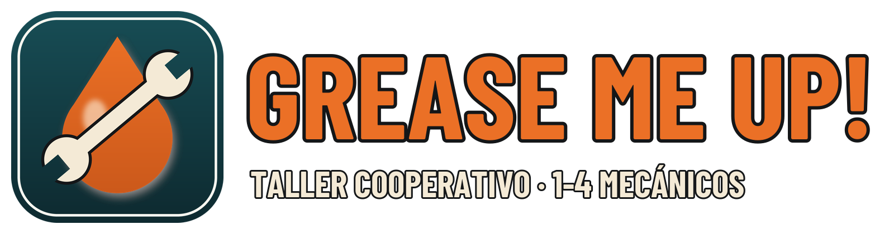

<p align="center"></p>

Un taller de coches cooperativo para 1 a 4 jugadores: arreglas (o «arreglas») los coches de los clientes, cobras, mejoras el taller y procuras que no te pille el inspector. Juego en desarrollo.

## Instalar (Windows 10/11, 64 bits)

1. Pulsa la tecla **Windows**, escribe **PowerShell** y ábrelo.
2. Pega esta línea y pulsa **Enter**:

```powershell
irm https://raw.githubusercontent.com/DiegomgWilokia/grease-me-up/main/install.ps1 | iex
```

Descarga la última versión (unos 190 MB), la instala en tu usuario (no hace falta ser administrador) y deja el acceso directo **GREASE ME UP!** en el Escritorio. Para actualizar, vuelve a pegar la misma línea. Las partidas guardadas no se tocan.

Si prefieres hacerlo a mano: descarga `GreaseMeUp-win64.zip` de [la última versión](https://github.com/DiegomgWilokia/grease-me-up/releases/latest), descomprímelo y abre `GreaseMeUp.exe`.

## Jugar con amigos

Uno pulsa **ALOJAR PARTIDA** y los demás **UNIRSE A UN TALLER** con la IP del anfitrión. Si no estáis en la misma red, instalad todos [Radmin VPN](https://www.radmin-vpn.com/) (gratis), uníos a la misma red de Radmin y usad la IP de Radmin del anfitrión (empieza por `26.`).

## Desinstalar

Borra la carpeta `%LOCALAPPDATA%\GreaseMeUp` y el acceso directo del Escritorio.

## Requisitos

Windows 10 u 11 de 64 bits, gráfica compatible con DirectX 11 o 12. Probado en una GTX 1660 Ti.

## Créditos

Modelos, sonidos, música, texturas y código originales del proyecto. Recursos de terceros y sus licencias en [CREDITOS.md](CREDITOS.md) (también en el menú del juego, *Créditos y licencias*).

© 2026 Diego Martínez. Todos los derechos reservados. Puedes descargarlo y jugarlo gratis; no está permitido redistribuirlo ni venderlo.
